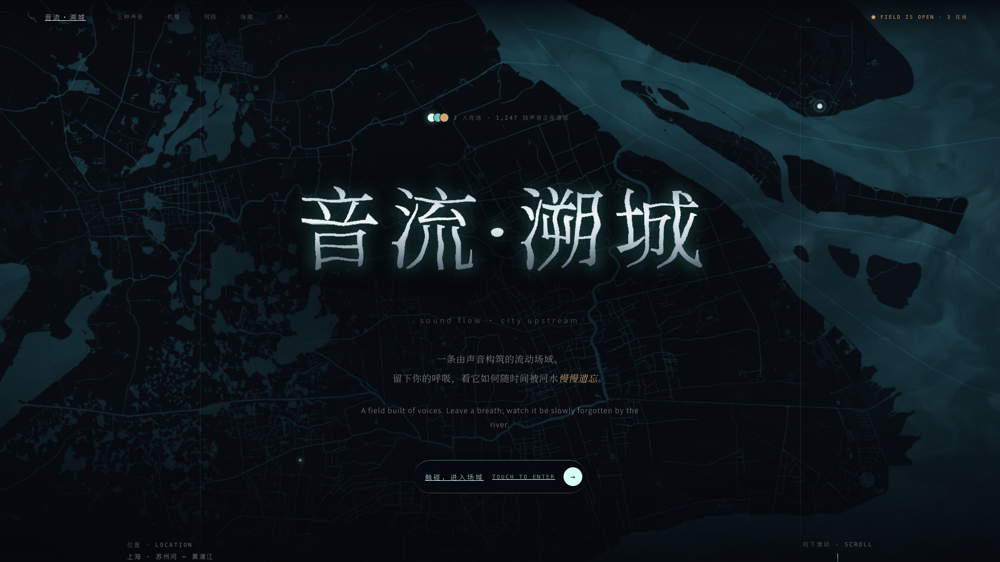
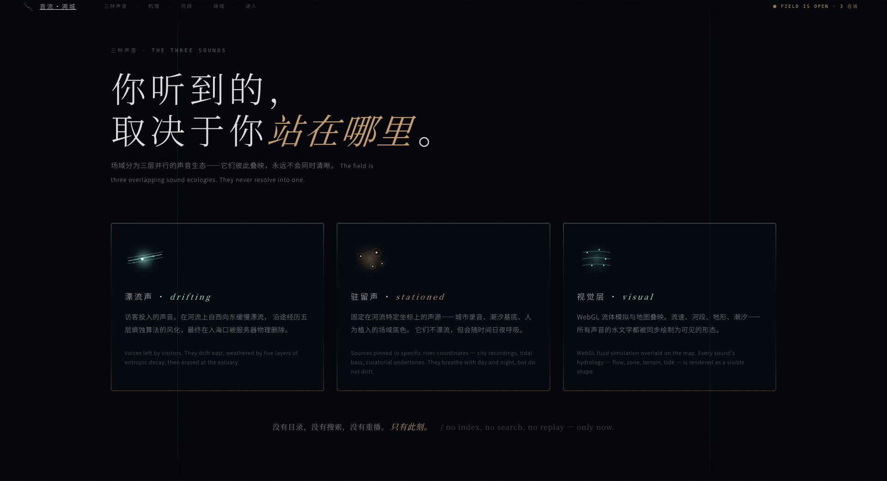
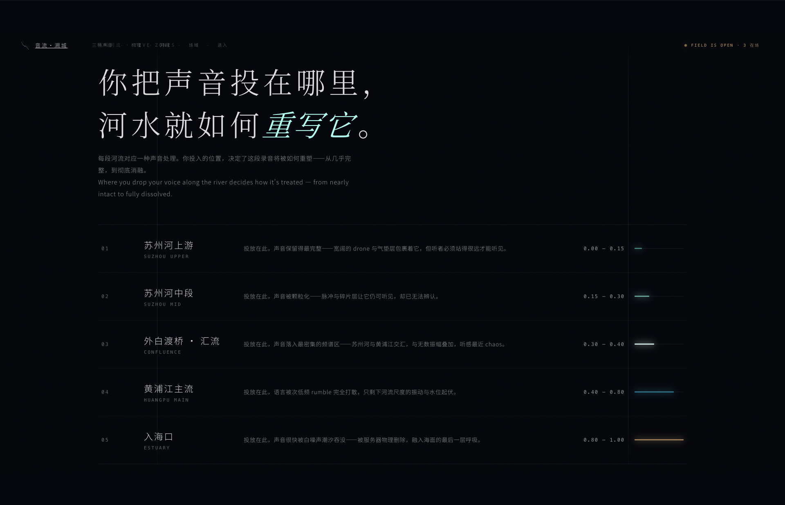
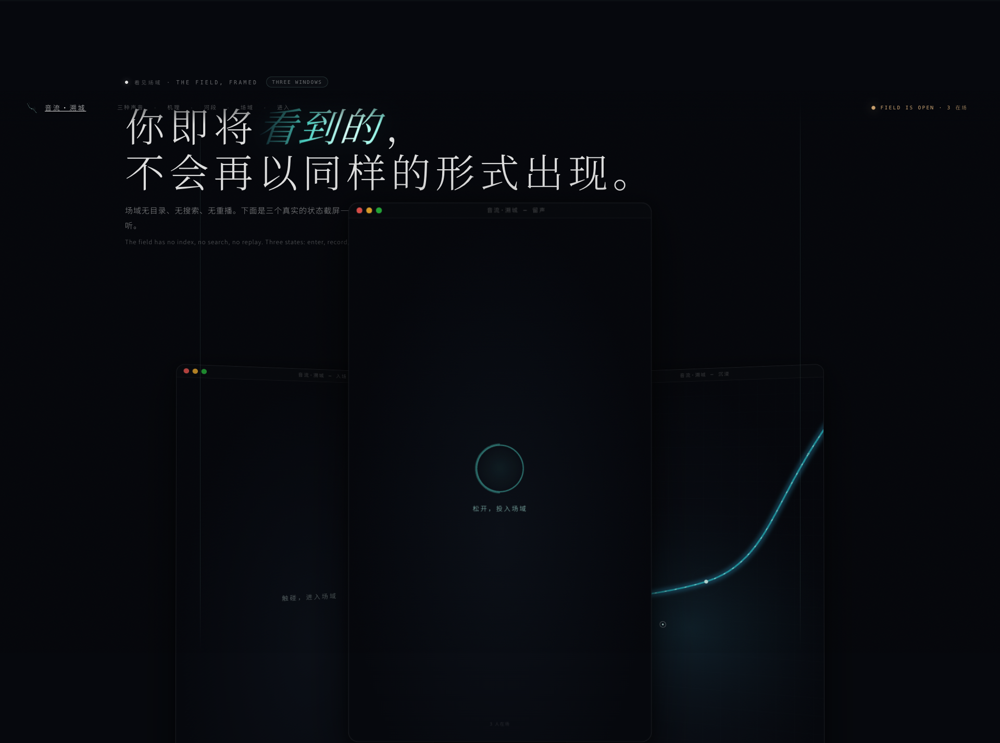
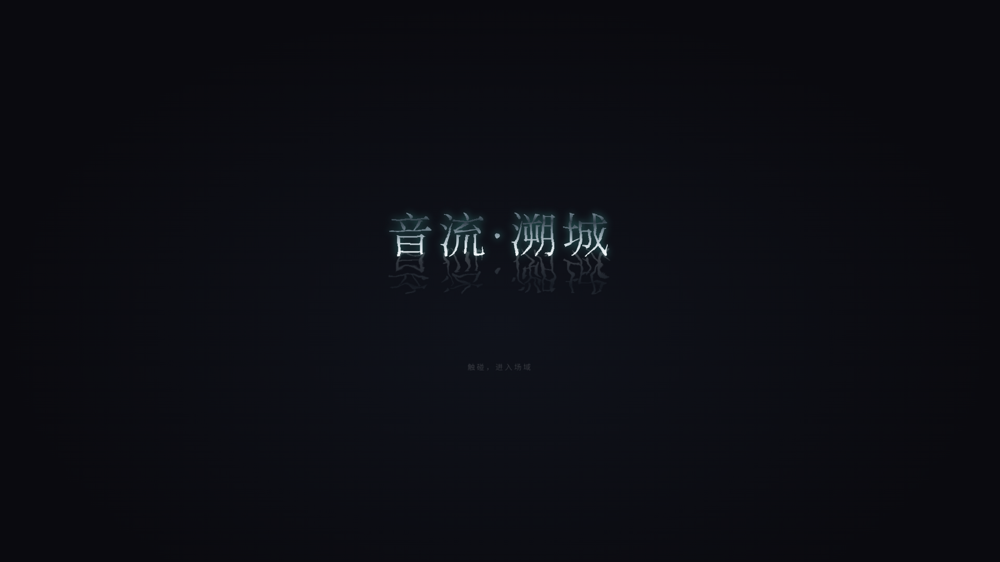
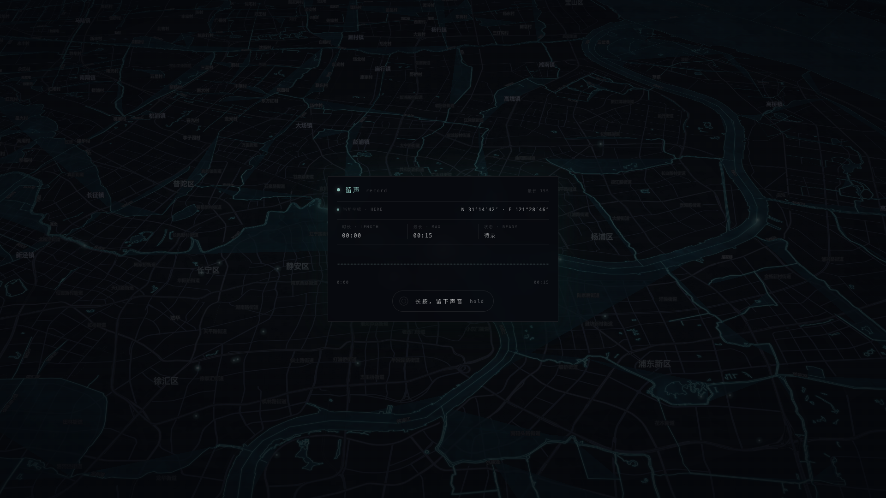
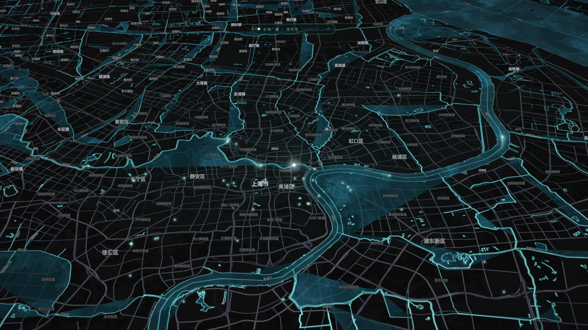
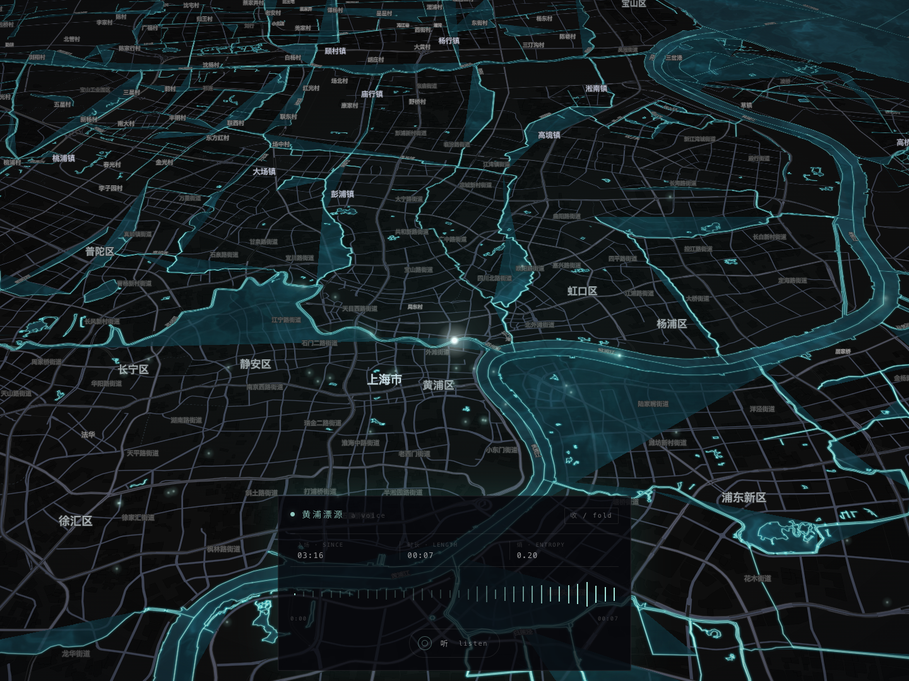
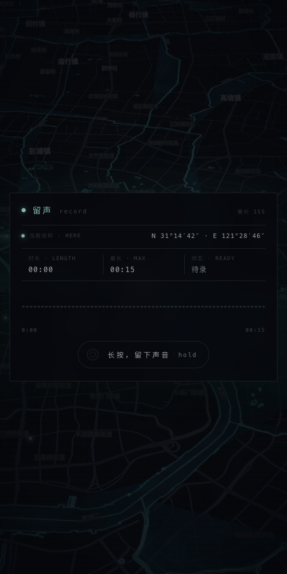

# 音流·溯城 · River

**一条由声音构筑的流动场域。**

作品类型：网络声音交互装置 / 生成声景 / 交互地图  
场域：上海 · 苏州河—黄浦江—入海口  
体验媒介：浏览器、耳机、麦克风

## 作品介绍

《音流·溯城》是一件以城市河流为线索的网络声音交互装置。作品将上海苏州河、黄浦江及入海口转化为一条可以聆听、进入和留下声音的数字水域。观众在浏览器中投入一段短暂的录音，它便成为河流中的一个声点，沿着水系缓慢漂移，在时间与河段的共同作用下逐渐改变，融入其他声音，最终走向消逝。

作品关注城市更新中那些细小而难以留存的经验：一句话、一次呼吸、一段环境里的回响。河流在这里既是城市的地理脉络，也是记忆变化的媒介。随着声音顺流而下，原本清晰的语言逐渐失去轮廓，细节被磨去，边缘被拉长，留下难以辨认却仍可感知的质地。个人表达由此进入一个不断变化的共同声景，与城市的日常、他人的痕迹和水流的节奏相遇。

体验从聆听开始。观众经过隐私告知与入场，在轻微的视觉引导中唤醒交互，通过长按录下一段声音，再进入地图观察它的漂流。作品将听觉与位置联系起来：听者所在的位置决定了能够遇见哪些上游声音；固定在河段上的城市录音，则为流动的个人声音提供持续变化的背景。点击声点，可以查看声音的时长、风化程度与当前状态，并聆听它此刻的样貌。

声音与视觉共同组织了这个场域。深色的城市地图上，青色水光勾勒河道，流动的光点提示声音的存在，琥珀色标记个人留下的痕迹。液态字标、细密波形与缓慢的呼吸动画延续了水流的时间感。苏州河上游、中段、外白渡桥汇流处、黄浦江主流及入海口构成五段连续的声音旅程，让城市空间成为声音变化的结构。

作品把“遗忘”写进声音的生命周期：录音经历风化、降解与融合后，原始文件按系统机制删除。消逝因此具有实际的技术过程，也成为观众能够感知的时间经验。每一次进入，都面对一条已经发生变化的河；每一次留声，也都意味着将一段属于自己的记忆交给流动。

《音流·溯城》邀请人们在城市的持续更新中放慢脚步，倾听个体痕迹如何汇入共同的环境，以及一段声音在失去原有形状之后，还能留下怎样的余韵。

## 简短版

《音流·溯城》是一件以苏州河—黄浦江为场域的网络声音交互装置。观众投入的录音沿河漂流，在时间与河段的作用下逐渐风化，与城市声景交织，最终消逝。作品通过交互地图、实时声音处理与流动光影，让个人记忆的留下、相遇与遗忘成为可以聆听和观看的过程。

## 代表性图片

### 01 · 首页与作品主视觉

液态字标叠映上海水系，建立作品的城市坐标与流动意象。适合作为作品封面。

### 02 · 三种声音与视觉生态

漂流声、驻留声与视觉层共同构成作品的体验结构。

### 03 · 五段河流与声音演变

从苏州河上游到入海口，地理河段与声音的变化过程相互对应。

### 04 · 交互场域预览

以并置窗口呈现入场、留声与聆听的交互关系。

### 05 · 入场与液态字标

以暗色留白、液态字形和水面倒影营造进入声音场域前的停顿。

### 06 · 录音投递界面

通过长按留声，将观众从聆听者引入共同声景的构成过程。

### 07 · 河流声景沉浸地图

真实城市地图与河道光点叠映，呈现声音漂流及空间聆听的场域。

### 08 · 声点聆听与风化波形

点击河流中的声点，查看时间、时长和熵值；波形显示声音被风化后的视觉状态。

### 09 · 移动端录音投递

竖屏呈现留声操作，突出位置、录音时长与长按交互。此图为桌面浏览器的移动尺寸布局截图。

---

素材说明：图片于 2026 年 11 月 5 日从当前本地前端实际渲染截取。安装页使用项目自带的阶段导航切换展示状态，截图中隐藏了开发导航、调参按钮及 UI Kit 水印，未修改项目源文件。截图未连接生产后端；地图声点与人数等数值可能来自前端默认值或离线演示，不代表实际在线活动。未录制或上传个人声音。作品介绍依据当前界面、源码与交互说明整理，声音上传、多人同步和最终删除的完整服务端流程未在本次截图中验证。
